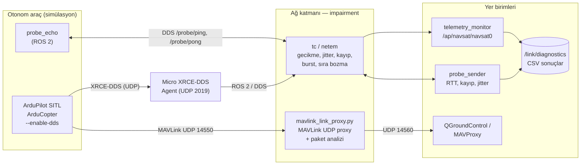

# SITL Otonom Uçuş ve Dağıtık Haberleşme Simülasyon Ortamı


> Otonom araç ile yer birimleri arasındaki haberleşmeyi **gerçek donanım olmadan**, **ağ gecikmesi ve paket
> kaybı altında** test etmek için kurulmuş simülasyon ortamı: ArduPilot SITL + ROS 2 / DDS + ağ bozma
> profilleri + gerçek zamanlı paket analizi.

| | |
|---|---|
| **Ortam** | Ubuntu 22.04 üzerinde simülasyon |
| **Rolüm** | Ortamın kurulumu, entegrasyonu ve haberleşme testleri |
| **Bileşenler** | ArduPilot SITL (DDS etkin), Micro XRCE-DDS Agent, ROS 2 Humble, CycloneDDS, tc/netem, pymavlink |

---

## İçindekiler
1. [Mimari](#1-mimari)
2. [Neler Yaptım](#2-neler-yaptım)
3. [Bileşenler](#3-bileşenler)
4. [Kurulum](#4-kurulum)
5. [Kullanım Senaryoları](#5-kullanım-senaryoları)
6. [Deney Tasarımı](#6-deney-tasarımı)
7. [Karşılaşılan Sorunlar ve Çözümler](#7-karşılaşılan-sorunlar-ve-çözümler)
8. [Testler ve CI](#8-testler-ve-ci)

---

## 1. Mimari



İki haberleşme yolu birlikte test edilir:

| Yol | Protokol | Ölçüm aracı | Bozma yöntemi |
|---|---|---|---|
| **ROS 2 / DDS** | ArduPilot DDS → XRCE agent → DDS (UDP 7400+) | `probe_sender` / `probe_echo`, `telemetry_monitor` | `netem.sh` (port filtreli) |
| **MAVLink** | UDP 14550 (SITL → yer) ve geri | `mavlink_link_proxy.py` | proxy içinde (kullanıcı alanı) veya `netem.sh --port 14550` |

## 2. Neler Yaptım

* **Kurulum:** Ubuntu 22.04 üzerinde ROS 2 Humble, ArduPilot SITL (DDS etkin derleme) ve Micro XRCE-DDS
  Agent entegrasyonu — tekrarlanabilir betikler: [`setup/`](setup/), [`docker/Dockerfile`](docker/Dockerfile).
* **Analiz:** Otonom araç ile yer birimleri arasındaki UDP/TCP paketlerinin gerçek zamanlı analizi:
  MAVLink proxy'si (mesaj türü başına hız, `seq` tabanlı kayıp, sıra bozulması, RFC 3550 jitter) ve
  ROS 2 düğümleri (RTT, kayıp, jitter, telemetri kesinti süreleri).
* **Test:** Yapay gecikme ve paket kaybı senaryolarında (`wifi`, `degraded`, `bad`, `burst`, `outage`)
  DDS QoS ayarlarının (RELIABLE / BEST_EFFORT, history depth), mesaj hızı ve boyutunun haberleşme
  sürekliliğine etkisinin denenmesi — [`scripts/run_experiments.sh`](scripts/run_experiments.sh).

## 3. Bileşenler

```
sitl-ros2-haberlesme-sim/
├── setup/
│   ├── install_ros2_humble.sh        # ROS 2 Humble + CycloneDDS
│   └── install_ardupilot_sitl.sh     # ArduPilot (--enable-dds) + micro_ros_agent
├── scripts/
│   ├── start_sitl_dds.sh             # agent | sitl
│   ├── run_experiments.sh            # ağ profili × QoS deney matrisi
│   └── analyze_results.py            # sonuç tablosu + grafik
├── netem/netem.sh                    # tc/netem profilleri (port filtreli)
├── config/cyclonedds_lo.xml          # DDS'i loopback + unicast'e zorlar
├── tools/
│   ├── mavlink_link_proxy.py         # MAVLink UDP proxy: bozma + analiz
│   └── linkmetrics.py                # kayıp / jitter / yüzdelik
├── ros2_ws/src/
│   ├── comm_interfaces/              # Probe.msg (seq, stamp, payload)
│   └── comm_analyzer/                # probe_sender, probe_echo, telemetry_monitor, launch
├── docker/Dockerfile
├── docs/EXPERIMENTS.md               # deney metodolojisi, hipotezler, sonuç şablonu
└── tests/                            # birim + proxy uçtan uca testi
```

### ROS 2 düğümleri

| Düğüm | Taraf | Görev |
|---|---|---|
| `probe_echo` | araç | `/probe/ping` → `/probe/pong` yansıtır |
| `probe_sender` | yer | `Probe(seq, stamp, payload)` yayınlar; RTT, kayıp (zaman aşımı), geç gelen, jitter ölçer; `/link/diagnostics` (DiagnosticArray) + CSV |
| `telemetry_monitor` | yer | ArduPilot DDS konusu (`/ap/navsat/navsat0`, `sensor_msgs/NavSatFix`): alım hızı, varışlar arası boşluk p95/max, mesaj yaşı |

QoS parametreleri: `reliability` (`reliable` / `best_effort` / `sensor`), `depth`, `rate_hz`, `payload_bytes`.

### Ağ profilleri (`netem/netem.sh`)

| Profil | Tek yön gecikme | Kayıp | Diğer | Temsil ettiği durum |
|---|---|---|---|---|
| `ideal` | 0 | 0 | — | referans |
| `wifi` | 5 ± 2 ms | %0,5 | — | iyi yerel kablosuz ağ |
| `degraded` | 50 ± 15 ms (normal dağılım) | %2 | %1 kopya | uzak mesafe, zayıf link |
| `bad` | 150 ± 50 ms | %10 (korelasyonlu) | %5 sıra bozma | sınırda link |
| `burst` | 20 ms | Gilbert-Elliott | — | anlık karıştırma / engel arkası |
| `outage` | — | %100 | — | link kopması |

`--port` ile yalnızca belirli trafiğe uygulanır (ör. DDS `7400-7450`, MAVLink `14550`), böylece SITL'in
kendi iç bağlantıları (fizik ↔ otopilot) etkilenmez.

## 4. Kurulum

```bash
git clone https://github.com/barankoc/sitl-ros2-haberlesme-sim.git && cd sitl-ros2-haberlesme-sim
./setup/install_ros2_humble.sh            # ~10 dk
./setup/install_ardupilot_sitl.sh         # ~20-30 dk (ArduPilot + agent derlemesi)

source /opt/ros/humble/setup.bash
cd ros2_ws && colcon build --symlink-install && source install/setup.bash && cd ..
pip install -r requirements.txt
```
Alternatif: `docker build -t sitl-comm -f docker/Dockerfile .`

## 5. Kullanım Senaryoları

**A) ArduPilot telemetrisini DDS üzerinden izleme**
```bash
./scripts/start_sitl_dds.sh agent        # Terminal 1
./scripts/start_sitl_dds.sh sitl         # Terminal 2
ros2 topic list | grep /ap               # Terminal 3: /ap/navsat/navsat0, /ap/geopose/filtered, ...
ros2 run comm_analyzer telemetry_monitor --ros-args -p expected_hz:=5.0
sudo ./netem/netem.sh apply degraded --port 2019    # XRCE linkine gecikme/kayıp
```

**B) DDS RTT / kayıp ölçümü (QoS karşılaştırma)**
```bash
export RMW_IMPLEMENTATION=rmw_cyclonedds_cpp
export CYCLONEDDS_URI=file://$PWD/config/cyclonedds_lo.xml
sudo ./netem/netem.sh apply bad --port 7400-7450
ros2 launch comm_analyzer comm_test.launch.py reliability:=best_effort depth:=1 rate_hz:=50.0
ros2 topic echo /link/diagnostics
```

**C) MAVLink paket analizi + bozma (netem gerektirmez)**
```bash
# SITL: --out udp:127.0.0.1:14550 ; QGroundControl: UDP 14560 dinler
python3 tools/mavlink_link_proxy.py --listen 14550 --forward 127.0.0.1:14560 \
        --delay 80 --jitter 20 --burst 0.02 0.25 0.9 --csv results/mavlink_burst.csv
```
```
[  12.0s] down (vehicle->gcs)   58.0 pkt/s   2810 B/s  loss  3.1% (lost 21, reord 0)  att-jitter 9.8 ms  delay p95 99.4 ms
[  12.0s] up (gcs->vehicle)      2.0 pkt/s     64 B/s  loss  0.0% (lost 0, reord 0)  att-jitter - ms  delay p95 98.7 ms
```
*(çıktı biçimi örneği)*

**D) Deney matrisinin tamamı**
```bash
DURATION=60 ./scripts/run_experiments.sh
python3 scripts/analyze_results.py results/     # Markdown tablo + results/summary.png
```

## 6. Deney Tasarımı

| Değişken | Değerler |
|---|---|
| Ağ profili | ideal, wifi, degraded, bad, burst |
| Güvenilirlik | RELIABLE, BEST_EFFORT |
| History depth | 1, 10 |
| Mesaj hızı | 10 / 50 / 100 Hz |
| Yük boyutu | 64 / 512 B |
| Süre | 60 s, ilk 5 s ısınma olarak dışarıda |

Ölçütler: uygulama seviyesi kayıp (zaman aşımı 1 s), geç gelen paketler, RTT p50/p95/max, RFC 3550 jitter,
telemetri kesinti süresi (en uzun varışlar arası boşluk).

Denenen veri akışı optimizasyonları:
* **Yüksek hızlı telemetri için BEST_EFFORT + depth 1:** en güncel veri önemlidir; kayıp paketin yeniden
  gönderilmesi gecikmeyi artırır ve eski veriyi taşır.
* **Komut / görev verisi için RELIABLE:** kaybedilmemesi gereken az sayıda mesaj.
* **Mesaj hızı ve boyutunun bütçelenmesi:** kayıplı linkte büyük ve sık mesajlar kuyrukları doldurur.
* **Ağ arayüzünün sabitlenmesi:** testin gerçekten bozulan arayüz üzerinden geçtiğinin garanti edilmesi
  (bkz. bölüm 7).

Metodoloji, sonuç şablonu ve sonuçların yorumlanması: [docs/EXPERIMENTS.md](docs/EXPERIMENTS.md)

## 7. Karşılaşılan Sorunlar ve Çözümler

| Sorun | Neden | Çözüm |
|---|---|---|
| netem uygulandığı hâlde DDS ölçümleri değişmiyor | DDS aynı makinede paylaşımlı bellek veya `eth0` kullanıyor, `lo` üzerinden geçmiyor | CycloneDDS + `config/cyclonedds_lo.xml` (yalnız `lo`, unicast keşif) |
| netem tüm SITL'i yavaşlattı | `lo` üzerindeki kural SITL fizik ↔ otopilot trafiğini de etkiliyor | `netem.sh --port` ile prio qdisc + u32 port filtresi |
| RTT'de gecikme iki kat görünüyor | `lo`'da her paket bir kez egress'ten geçer; ping ve pong ayrı paketler | Beklenen davranış: RTT ≈ 2 × tek yön gecikme |
| DDS derlemesinde hata | ArduPilot DDS kod üreteci `empy` 3.x istiyor | `pip install empy==3.3.4` |
| Mesaj yaşı negatif / anlamsız | Araç ve yer farklı saat kullanıyor | `use_sim_time` veya aynı saat kaynağı; aksi halde yalnızca RTT kullanılır |

## 8. Testler ve CI

* `pytest tests` — kayıp sayacı (sarma, sıra bozma, kopya), jitter, özet istatistik, **proxy uçtan uca**
  (%10 kayıp + 30 ms gecikme enjekte edilir; ölçülen kayıp = enjekte edilen kayıp, gecikme ≥ 30 ms).
* `colcon build` + `colcon test` — ROS 2 paketleri (`ros:humble` konteyneri).
* CI içinde 15 s'lik gerçek DDS ping/pong testi; sonuç CSV'si artefakt olarak saklanır.

---

**Baran Koç** — [LinkedIn](https://linkedin.com/in/barankoc) · [GitHub](https://github.com/barankoc)
